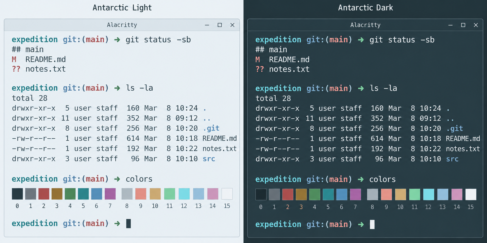

# Antarctic for Alacritty

Light and dark themes based on the shared [Antarctic palette](https://github.com/AntarcticTheme/.github/blob/main/profile/README.md).



## Requirements

Install [Alacritty](https://github.com/alacritty/alacritty/blob/master/INSTALL.md) 0.14+.

These instructions use TOML and `[general].import`. 

## Install

Make sure you have the folder `"$HOME/.config/alacritty/themes"` already created.

Use a current TOML-based Alacritty release. Download both files:

```sh
curl -fL https://raw.githubusercontent.com/AntarcticTheme/Alacritty/main/themes/antarctic-light.toml -o "$HOME/.config/alacritty/themes/antarctic-light.toml"
curl -fL https://raw.githubusercontent.com/AntarcticTheme/Alacritty/main/themes/antarctic-dark.toml -o "$HOME/.config/alacritty/themes/antarctic-dark.toml"
```

Edit `$HOME/.config/alacritty/alacritty.toml`:

```toml
[general]
import = ["~/.config/alacritty/themes/antarctic-dark.toml"]
```

If `[general]` or `import` already exists, add to it rather than duplicating it.

Use `antarctic-light.toml` for light mode. Explicit colors in your main config override the imported theme.

On Windows, create the destination directory if necessary, then download the same files using the GitHub raw-file download button and copy the files into `%APPDATA%\alacritty\themes` and import the file relative to `%APPDATA%\alacritty\alacritty.toml`, for example `import = ["themes/antarctic-dark.toml"]` under `[general]`.

Includes foreground, background, cursor, selection, and all 16 ANSI colors.


## Updates

To update, repeat the download/copy steps, then restart the application or reload its configuration.

Released under the MIT license. See [LICENSE](LICENSE).
